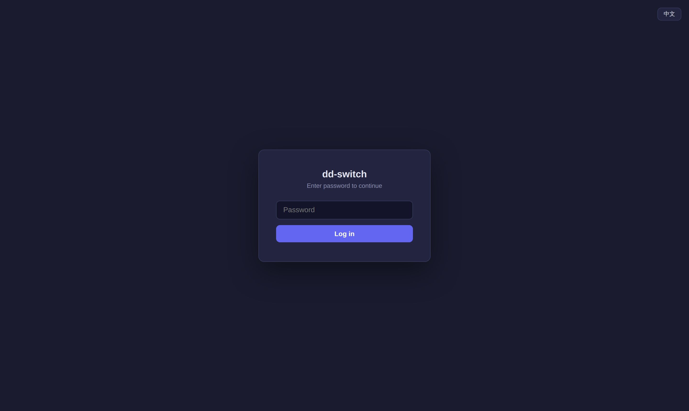
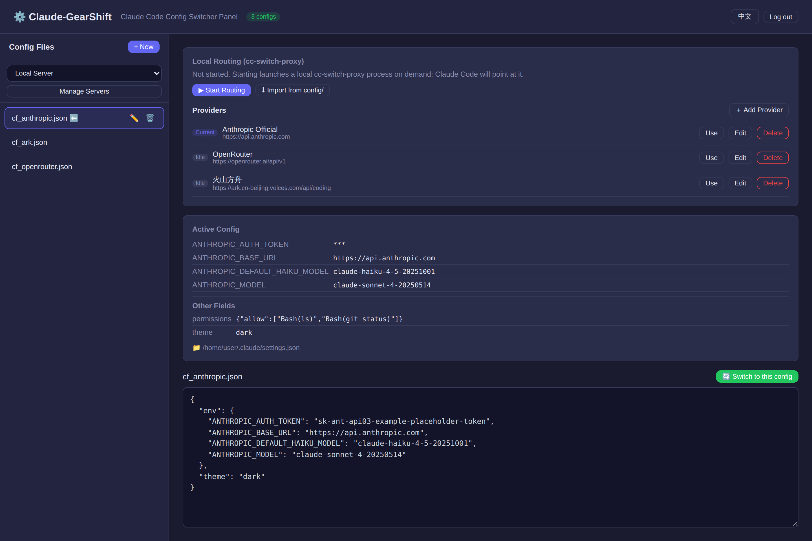
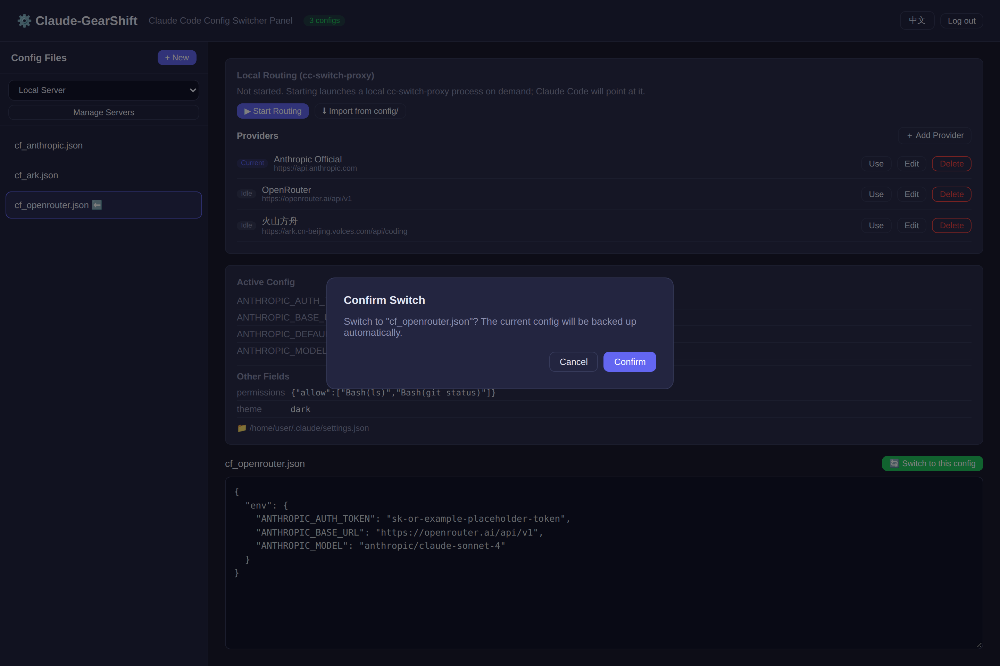

# ⚙️ Claude-GearShift

**English | [简体中文](README.zh-CN.md)**

Shift gears for Claude Code — quickly switch model/provider configs on Linux while leaving every other setting untouched.

The Web UI (`dd-switch/`, Flask + waitress, browser-based, password-protected)
is the supported interface, working off the shared `config/` directory with
the same switch semantics (replace `env` only → atomic write).

> **Note:** the terminal script `switch_claude_config.sh` was retired and
> removed — the Web UI is the only supported interface.

## Why this panel

Running Claude Code across **several Linux servers** is the case this panel is
built for. Each box keeps its own provider / model / API key in
`~/.claude/settings.json`, and switching a provider normally means SSHing into
every machine and editing JSON by hand — easy to miss one, easy to typo.

One password-protected Web UI fixes that:

- **Every machine in one place** — add your servers once (SSH key auth), then
  read, switch and scan each server's `~/.claude/settings.json` from a single page.
- **Predefined profiles, one-click switch** — keep each provider as a file under
  `config/`; switching replaces only `env` and writes atomically, so `theme` /
  `permissions` / `skills` stay untouched.
- **Optional local routing** — point a server's Claude Code at the
  `cc-switch-proxy` gateway and change upstream providers centrally, without
  re-editing that machine's config each time.
- **Safe by default** — password-protected end to end, credentials masked in the
  UI, automatic backup before every switch.

No more per-server manual editing, no more drift between machines.

## Web UI Usage

```bash
cd dd-switch
python3 app.py
# open http://localhost:10086
```

Requires `flask` + `waitress` + `paramiko` + `cryptography` — `pip install flask waitress paramiko cryptography`.

- Set the access password via the `DD_SWITCH_PASSWORD` env var (defaults to `admin`)
  > **Deployment note:** always set `DD_SWITCH_PASSWORD` in production — without it, the UI falls back to the default password `admin`.
- Production mode serves via waitress; `DD_SWITCH_DEBUG=1` falls back to Flask's dev server
- Browse / create / edit / delete / switch configs under `config/` right from the page
- 中/EN language toggle in the top-right corner (your choice is remembered)
- Optional **local routing** with its own config page: manage providers (stored in cc-switch's DB), start/stop the `cc-switch-proxy` gateway, and apply it to Claude Code — see [Local Routing](#local-routing-cc-switch-proxy-optional)

### Multi-Server SSH Support

Manage Claude Code configs on **multiple remote servers** from one Web UI:

- **SSH key-based authentication** — supports encrypted keys with passphrase
- **Passphrase encryption** — SSH key passphrases are encrypted with your Web UI login password (PBKDF2 + Fernet), never stored in plain text
- **Automatic operation** — once logged in, SSH connections are established automatically without re-entering credentials
- **Remote config management** — read, switch, and scan configs on remote servers via SSH/SFTP
- **Server management** — add / edit / delete / test servers from the sidebar

> **Note:** Remote servers use the fixed path `~/.claude/settings.json`.

### 🔒 Password Protection

The Web UI is **password-protected end to end** — every page and every API endpoint requires a valid login session:

| Layer | Behavior |
|---|---|
| **Login** | Password comes from `DD_SWITCH_PASSWORD` (default `admin` — always override it in production) |
| **Session** | Server-side token stored in an `HttpOnly` cookie, 8-hour expiry, `SameSite=Lax` |
| **Coverage** | Unauthenticated page visits redirect to the login screen; unauthenticated API calls return `401` + `login_required` |
| **Cache safety** | All responses carry `no-store` headers — config contents never linger in the browser cache |
| **Token masking** | API tokens shown in the UI are truncated (`sk-ant-api03...`), never rendered in full |
| **Logout** | The Log out button invalidates the session server-side immediately |



### Screenshots

| Dashboard | Confirm switch |
|---|---|
|  |  |

## Local Routing (cc-switch-proxy, optional)

An opt-in mode where Claude Code talks to a local `cc-switch-proxy` gateway
instead of a provider directly. `cc-switch-proxy` is the headless daemon built
from a patched cc-switch (see [`patches/`](patches/README.md)); dd-switch only
starts/stops it and points Claude Code at it. Providers come from cc-switch's
SQLite database.

> **Status: ✅ verified end-to-end.** `dd-switch/test_suite/test_local_routing_e2e.py`
> drives the **real** `cc-switch-proxy` binary against a **live** upstream
> (`../../test_data/.testdata`): OpenAI-Chat protocol relay (non-streaming +
> SSE streaming), tier-alias model mapping, provider CRUD and the
> start → apply → traffic → stop lifecycle all pass. Prerequisites missing
> (no binary, no WebKitGTK runtime libs, no endpoint) ⇒ the suite skips.
> Details in [`TEST-REPORT.md`](TEST-REPORT.md). A top-level `"api_format"` in
> `config/*.json` is likewise honored on `provider import`.

**When do you actually need it** — local routing only earns its keep in two
situations:

1. **Protocol relay (转接口)** — the upstream speaks OpenAI / Gemini style; the
   proxy converts protocols so Claude Code keeps working as-is, or several
   upstreams funnel behind one local endpoint. Set the provider's upstream
   protocol when adding it (defaults to `anthropic` passthrough).
2. **Outbound proxy (加代理)** — reaching the upstream requires an
   HTTP/HTTPS/SOCKS5 network proxy. Set it before starting the daemon: the
   local-routing page in the Web UI has an "Outbound proxy" box (it writes the
   same global-proxy setting the desktop app uses, via
   `cc-switch-proxy proxy set --url …` on headless hosts); `HTTP_PROXY` /
   `HTTPS_PROXY` env vars work too. A daemon restart makes it effective.

If you simply connect directly to an Anthropic-protocol provider and the
network is fine, the ordinary switch flow is enough — no need for local
routing.

**How it works**

1. **Add providers** — the local-routing panel lists providers from
   `~/.cc-switch/cc-switch.db`. Add/edit them there, or import the existing
   `config/*.json` in one click. Pick one as current. Switching providers
   later is one step — set another as current and the router picks it up on
   the next request, no restart.
2. **Start routing** — dd-switch spawns `cc-switch-proxy --db … --port 9301`
   (loopback-only; a plain child process, not a service), waits for `/health`,
   and snapshots the managed `env` keys from `~/.claude/settings.json`.
3. **Apply** — applies to the currently active config only (no other profile
   is touched): writes `ANTHROPIC_BASE_URL=http://127.0.0.1:9301`, the
   `PROXY_MANAGED` placeholder token, and the stable tier aliases
   (`claude-sonnet-5` …). The proxy maps those aliases to the current provider's
   real models (per-provider, from the provider's `env`). Everything else in
   `env` and every non-`env` field is left alone.
4. **Stop routing** — the managed keys are restored from the snapshot, then the
   process group is terminated. A failed restore keeps the state so the
   operation can be retried.

**Setup** — all settings live in dd-switch's `EnvironmentFile`
(`~/.config/systemd/user/dd-switch.env`, mode 0600); nothing is hardcoded:

| Variable | Required | Meaning |
|---|---|---|
| `DD_SWITCH_ROUTE_ENABLED` | yes | `1` turns the feature on |
| `DD_SWITCH_ROUTE_PROXY_BIN` | no | `cc-switch-proxy` executable; defaults to `PATH` |
| `DD_SWITCH_ROUTE_DB` | no | cc-switch SQLite path; defaults to `~/.cc-switch/cc-switch.db` |
| `DD_SWITCH_ROUTE_APP` | no | app type; defaults to `claude` |
| `DD_SWITCH_ROUTE_PORT` | no | listen port; defaults to `9301` |

```bash
chmod 600 ~/.config/systemd/user/dd-switch.env
# append the variables above, then:
systemctl --user restart dd-switch
```

### cc-switch-proxy dependencies (compile vs run)

| Scope | What it needs | How to provide it |
|---|---|---|
| **Run** | `libwebkit2gtk-4.1.so.0` and `libjavascriptcoregtk-4.1.so.0` plus their deps (`libgstgl-1.0`, `libwebpdemux`, `libharfbuzz-icu`, `libmanette-0.2`, `libenchant-2`, `libhyphen`, `libsecret-1`, mesa/egl/gbm, dictionaries). GTK 3 / libsoup 3 are usually already present. | Root: `sudo apt-get install libwebkit2gtk-4.1-0` (pulls the rest). Without root: unpack the runtime `.deb`s into a directory and set `LD_LIBRARY_PATH` — recipe in [`patches/README.md`](patches/README.md#prebuilt-binary). |
| **Compile** | Full Tauri Linux prerequisites — WebKitGTK/GTK **dev** packages — because the proxy links the whole `cc_switch_lib` crate (`cc-switch/src-tauri`), not because of OAuth. | See [`cc-switch/CONTRIBUTING.md`](../cc-switch/CONTRIBUTING.md); a root-free build is possible by extracting dev `.deb`s into a sysroot and pointing `pkg-config`/`LIBRARY_PATH` at it. |

> **OAuth limit**: login-based providers (GitHub Copilot, ChatGPT/Codex, xAI) only
> work through the cc-switch **desktop** app — the headless daemon has no
> `AppHandle`, so only API-key providers (Anthropic, OpenAI-compatible, Gemini,
> OpenRouter, …) work.

**Notes and limits**

- Get `cc-switch-proxy` first: use the prebuilt binary in `patches/bin/`
  (Linux x86_64) or build it — see [`patches/README.md`](patches/README.md);
  compile/run dependencies are in the table above.
- The binary is resolved from `PATH` (or `DD_SWITCH_ROUTE_PROXY_BIN`) — use
  whatever environment you would normally launch it in.
- Provider tokens land in cc-switch's DB (user-private) and are masked in every
  API response — never put them in `config/*.json`.
- `127.0.0.1:9301` only serves Claude Code on **this** machine. Remote servers
  managed over SSH have no routing control.
- The process does not survive a reboot. After a reboot, "Start routing"
  re-spawns it and reuses the existing snapshot.
- While routing is active, profile switching is locked (it would corrupt the
  restore snapshot) — stop routing first.
- Run the tests with `python3 -m unittest discover -s test_suite` from
  `dd-switch/`. Unit suites are fully mocked; `test_local_routing_e2e.py`
  drives the real proxy binary and a live upstream and skips cleanly when
  either is unavailable.

## Config Directory Structure

Drop one JSON file per provider into `config/`:

```
config/
├── cf_ark_177.json
├── cf_anthropic.json
├── cf_openrouter.json
└── cf_aws_bedrock.json
```

Each JSON only needs an `env` block, for example:

```json
{
  "env": {
    "ANTHROPIC_AUTH_TOKEN": "sk-ant-...",
    "ANTHROPIC_BASE_URL": "https://api.anthropic.com",
    "ANTHROPIC_MODEL": "claude-sonnet-4-20250514"
  }
}
```

More optional fields: [Claude Code environment variables](https://docs.anthropic.com/en/docs/claude-code/settings).

## Features

| Step | What it does |
|---|---|
| **Scan** | Walks the config directory for `.json` files |
| **Validate** | Syntax-checks each file; invalid files are skipped with the reason |
| **Summarize** | Shows the current config's Base URL and Model |
| **Select** | Pick a config from the sidebar list |
| **Preview** | Shows the full selected file before switching |
| **Confirm** | Switches only after explicit confirmation |
| **Back up** | Backs up the current config to `settings.json.bak.<timestamp>` before switching |
| **Merge** | Replaces only `env`, preserving `theme` / `permissions` / `actions` / `skills` |
| **Atomic write** | Temp file + `mv rename` — no half-written JSON |
| **Multi-server** | Manage configs on multiple remote servers via SSH key auth |
| **Passphrase encryption** | SSH key passphrases encrypted with Web UI password (PBKDF2 + Fernet) |

## Dependencies

**Web UI** (`dd-switch/`) — Python 3.10+, listed in `requirements.txt`:

```bash
pip install -r requirements.txt   # flask, waitress, paramiko, cryptography
```

| Package | Why |
|---|---|
| `flask` | HTTP app |
| `waitress` | production WSGI server |
| `paramiko` | SSH to remote servers |
| `cryptography` | encrypts SSH key passphrases (PBKDF2 + Fernet) |

**Optional — local routing (cc-switch-proxy):** not a pip dependency. Local
routing is provided by the `cc-switch-proxy` daemon built from a patched
cc-switch (see [`patches/README.md`](patches/README.md)). Everything else works
without it.

## Workflow Example

```bash
# 1. Prepare configs
mkdir -p config
cp ~/.claude/settings.json config/cf_default.json
# edit or fetch additional configs
```

2. Switch — in the Web UI: pick a config in the left sidebar, review it in
   the preview pane, confirm to switch. The current config is backed up
   automatically (`settings.json.bak.<timestamp>`); only `env` is replaced.
