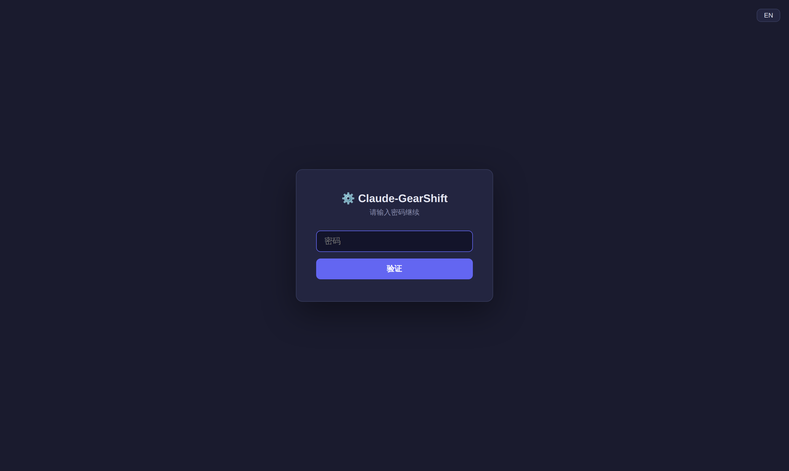
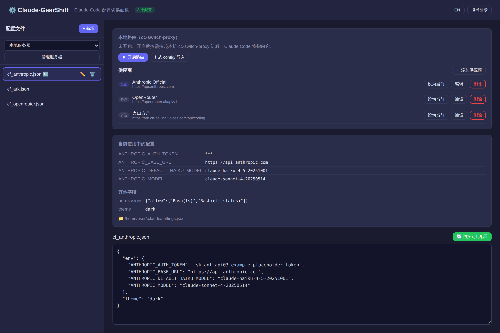

# ⚙️ Claude-GearShift

**[English](README.md) | 简体中文**

给 Claude Code 换挡 —— 在 Linux 上快速切换模型/供应商配置，保留其他设置不变。

Web UI（`dd-switch/`，Flask + waitress，浏览器操作，密码保护）是受支持的
使用方式，共用 `config/` 目录和同一套切换逻辑（只替换 `env` → 原子写入）。

> **说明：** 终端脚本 `switch_claude_config.sh` 已退役并删除——Web UI 是唯一
> 受支持的使用方式。

## 这个面板解决什么问题

**多台 Linux 服务器**上跑 Claude Code，正是这个面板的用武之地。每台机器都要在
`~/.claude/settings.json` 里单独配供应商 / 模型 / API key；想换个供应商，传统做法是
挨台 SSH 上去手改 JSON——漏掉一台、手抖写错都很常见。

一个带密码的 Web 面板把这些收拢到一处：

- **一处管所有机器** —— 服务器加一次（SSH 密钥认证），在一页里读取、切换、扫描每台
  的 `~/.claude/settings.json`。
- **预设配置档，一键切换** —— 每套供应商存成 `config/` 下的一个文件；切换只替换
  `env` 并原子写入，`theme` / `permissions` / `skills` 原样不动。
- **可选的本地路由** —— 让某台服务器的 Claude Code 指向 `cc-switch-proxy` 网关，
  集中更换上游供应商，不必每次回去改那台机器的配置。
- **默认安全** —— 全程密码保护、UI 里凭据打码、每次切换前自动备份。

不必再逐台手改，也不会出现机器之间的配置漂移。

## Web UI 用法

```bash
cd dd-switch
python3 app.py
# 打开 http://localhost:10086
```

需要 `flask` + `waitress` + `paramiko` + `cryptography`（`pip install flask waitress paramiko cryptography`）。

- 访问密码通过环境变量 `DD_SWITCH_PASSWORD` 设置（不设则默认 `admin`）
  > **部署提醒：** 生产环境务必设置 `DD_SWITCH_PASSWORD`，否则会回退到默认密码 `admin`。
- 生产模式 waitress；`DD_SWITCH_DEBUG=1` 时走 Flask dev server
- 页面可直接查看 / 新建 / 编辑 / 删除 / 切换 `config/` 下的配置
- 右上角 中/EN 语言切换（记忆选择）
- 可选的**本地路由**有独立配置页：管理供应商（存在 cc-switch 的库里）、启停 `cc-switch-proxy` 网关，并应用到 Claude Code——见[本地路由](#本地路由cc-switch-proxy可选)

### 多服务器 SSH 支持

在一个 Web UI 中管理**多台远程服务器**的 Claude Code 配置：

- **SSH 密钥认证** — 支持加密密钥和密码短语
- **密码短语加密** — SSH 密钥密码短语使用 Web UI 登录密码加密存储（PBKDF2 + Fernet），绝不明文保存
- **自动操作** — 登录后自动建立 SSH 连接，无需重复输入凭证
- **远程配置管理** — 通过 SSH/SFTP 读取、切换、扫描远程服务器上的配置
- **服务器管理** — 侧边栏添加 / 编辑 / 删除 / 测试服务器连接

> **注意：** 远程服务器使用固定路径 `~/.claude/settings.json`。

### 🔒 密码保护

Web UI **全程密码保护** —— 每个页面、每个 API 接口都必须持有有效的登录会话：

| 层 | 行为 |
|---|---|
| **登录** | 密码来自 `DD_SWITCH_PASSWORD`（默认 `admin` —— 生产环境务必覆盖） |
| **会话** | 服务端 token 存于 `HttpOnly` cookie，8 小时过期，`SameSite=Lax` |
| **覆盖范围** | 未登录访问页面 → 跳转登录页；未登录调用 API → 返回 `401` + `login_required` |
| **缓存安全** | 所有响应带 `no-store` 头 —— 配置内容不会滞留在浏览器缓存 |
| **token 脱敏** | 界面上显示的 API token 一律截断（`sk-ant-api03...`），从不完整渲染 |
| **登出** | 点击退出登录立即在服务端作废会话 |



### 截图

| 主面板 | 切换确认 |
|---|---|
|  |  |

## 本地路由（cc-switch-proxy，可选）

一种可选模式：让 Claude Code 不再直连供应商，而是指向本机的 `cc-switch-proxy`
网关。`cc-switch-proxy` 是由打过补丁的 cc-switch 构建出的无界面守护进程
（见 [`patches/`](patches/README.md)）；dd-switch 只负责启停它并把 Claude Code
指过去。供应商来自 cc-switch 的 SQLite 库。

> **现状：✅ 整体已通，待优化逻辑。** `dd-switch/test_suite/test_local_routing_e2e.py`
> 用**真实** `cc-switch-proxy` 二进制对着**真实**上游（`../../test_data/.testdata`）
> 验证：OpenAI-Chat 协议转换（非流式 + SSE 流式）、供应商 CRUD、以及
> 启动 → 应用 → 跑流量 → 停止生命周期 全部通过。按模型路由也做了实测——被分流模型
> 打到死节点 URL 会失败而不回落默认接入点，改成只带 format 的路由即恢复；模型路由的
> format 决定上游路径（`/v1/responses` 或 `/v1/chat/completions`，用本机记录型 sink
> 验证）。应用只写两个网络分派键——模型名由用户自己负责。前置条件缺失（无二进制、
> 无 WebKitGTK 运行库、无接入点）时自动跳过。详见
> [`TEST-REPORT.md`](TEST-REPORT.md)。
> 导入的配置文件里写顶层 `"api_format"`，在 `provider import` 时同样被识别。

**什么时候才需要它** —— 本地路由只在两种场景下有价值：

1. **转接口** —— 上游说 OpenAI / Gemini 等非 Anthropic 协议，由代理做协议转换
   让 Claude Code 照常使用；或把多个上游统一成一个本机入口。添加供应商时选好
   上游协议（缺省 `anthropic` 透传）。
2. **加代理** —— 出站请求必须经 HTTP/HTTPS/SOCKS5 网络代理才能到达上游。需要
   在**启动守护进程前**配置好：Web 界面的本地路由页有「出站代理」一栏（写入
   与桌面端「全局代理」同一份设置；无界面的机器也可以用 `cc-switch-proxy
   proxy set --url …`），或直接用 `HTTP_PROXY` / `HTTPS_PROXY` 环境变量
   （守护进程会跟随）——配置后需重启 cc-switch-proxy 才生效。

只是直连 Anthropic 协议供应商、网络也通畅的话，用原来的切换流程直连即可，
不必开本地路由。

### 供应商的两种类型（接入点配置在左栏「本地路由」区块）

- **单类型** —— 上游只提供**一种**接口形态（只有 `/v1/messages`，或只有
  `/v1/responses`）。主要配置即可：名称 + 接入点（Base URL）+ Key + 那一种协议；
  路由把 Anthropic 请求按该协议转换后转发。
- **混合类型** —— 上游像 opencode 那样多种接口形态并存（`/v1/messages` 与
  `/v1/responses` 等同时可用），不同模型可能要不同接口、甚至不同接入点。编辑器里
  配两张表：
  - **节点** `{name, url?, key?}` —— 给全 url+key 就是独立接入点；只给 key 就是
    **多 key 补充**（同一接入点、不同模型用不同凭据）；省略的字段回落到默认接入点。
  - **模型路由** `{模型名: {node, format}}` —— 每个模型走哪个节点、哪种接口形态；
    只给 `format` 就是单纯换协议。

**模型名由你负责**：面板不再代写档位别名。在 Claude Code 的
`~/.claude/settings.json` 里自己写真实上游模型名，例如：

```json
{ "env": { "ANTHROPIC_DEFAULT_OPUS_MODEL": "hy4-preview[1M]" } }
```

请求里的模型名（剥掉 `[1m]` 后缀后）命中该供应商的模型路由表就按表分流；
未命中走默认接入点与默认协议。所以表里的模型键要写**剥掉 [1m] 后缀**的名字
（`hy4-preview`）。

**工作方式**

1. **配置供应商** —— 左栏「本地路由」区块列出 `~/.cc-switch/cc-switch.db` 里的
   供应商。点供应商进主区编辑（新旧两种类型，见上节），或点「从本机导入」选
   浏览器所在设备（如 Windows）上的 `*.json` 配置文件导入——不读服务器的
   `config/`。选一个作为当前供应商。以后换供应商只要一步——把另一个设为当前，
   代理下个请求即生效，无需重启。
2. **开启路由** —— dd-switch 拉起 `cc-switch-proxy --db … --port 9301`
   （仅回环；普通子进程，不是服务），等待 `/health` 就绪，并快照
   `~/.claude/settings.json` 里受管的 `env` 键。
3. **应用** —— 只作用于当前已生效的配置（其他配置一概不动）：只写两个网络分派键
   —— `ANTHROPIC_BASE_URL=http://127.0.0.1:9301` 与占位凭据 `PROXY_MANAGED`。
   模型名（`ANTHROPIC_MODEL` / `ANTHROPIC_DEFAULT_*_MODEL`）由你自己在
   settings.json 里写，应用不碰它们。`env` 里的其他键和所有非 `env` 字段一概不动。
4. **关闭路由** —— 从快照恢复受管的键，然后结束进程组。恢复失败会保留状态以便重试。

**配置** —— 全部设置都在 dd-switch 的 `EnvironmentFile`
（`~/.config/systemd/user/dd-switch.env`，权限 0600），不写死任何东西：

| 变量 | 必填 | 含义 |
|---|---|---|
| `DD_SWITCH_ROUTE_ENABLED` | 是 | `1` 开启该功能 |
| `DD_SWITCH_ROUTE_PROXY_BIN` | 否 | `cc-switch-proxy` 可执行文件；默认从 `PATH` 找 |
| `DD_SWITCH_ROUTE_DB` | 否 | cc-switch 的 SQLite 路径；默认 `~/.cc-switch/cc-switch.db` |
| `DD_SWITCH_ROUTE_APP` | 否 | 应用类型；默认 `claude` |
| `DD_SWITCH_ROUTE_PORT` | 否 | 监听端口；默认 `9301` |

```bash
chmod 600 ~/.config/systemd/user/dd-switch.env
# 追加上述变量，然后：
systemctl --user restart dd-switch
```

### cc-switch-proxy 的依赖（编译期 / 运行期）

| 阶段 | 需要什么 | 怎么提供 |
|---|---|---|
| **运行期** | `libwebkit2gtk-4.1.so.0` 与 `libjavascriptcoregtk-4.1.so.0` 及其依赖（`libgstgl-1.0`、`libwebpdemux`、`libharfbuzz-icu`、`libmanette-0.2`、`libenchant-2`、`libhyphen`、`libsecret-1`，以及 mesa/egl/gbm、词典包）。GTK 3 / libsoup 3 一般已随系统装好。 | 有 root：`sudo apt-get install libwebkit2gtk-4.1-0`（会自动带上其余依赖）。免 root：把运行库 `.deb` 解包到一个目录，再用 `LD_LIBRARY_PATH` 指过去——命令见 [`patches/README.md`](patches/README.md#prebuilt-binary)。 |
| **编译期** | 完整的 Tauri Linux 前置——WebKitGTK/GTK **dev** 包。因为 proxy 链接的是整个 `cc_switch_lib` crate（`cc-switch/src-tauri`），这是 **Tauri 的要求**，与 OAuth 无关。 | 见 [`cc-switch/CONTRIBUTING.md`](cc-switch/CONTRIBUTING.md)；免 root 编译也可行：把 dev `.deb` 解包成 sysroot，再用 `pkg-config`/`LIBRARY_PATH` 指过去。 |

> **OAuth 限制**：走登录授权的供应商（GitHub Copilot、ChatGPT/Codex、xAI）只能在
> cc-switch **桌面端**里用——headless 守护进程没有 `AppHandle`，只支持 API Key 类
> 供应商（Anthropic、OpenAI 兼容、Gemini、OpenRouter 等）。

**说明与限制**

- 先拿到 `cc-switch-proxy`：用 `patches/bin/` 里的预编译二进制（Linux x86_64），
  或自行构建——见 [`patches/README.md`](patches/README.md)；编译/运行依赖见上表。
  开发者说明：被打补丁的源码 `cc-switch` 以 **git submodule** 形式包含在本仓库里
  （钉住补丁适用的那个 commit）——用 `--recurse-submodule` 克隆，或克隆后补一句
  `git submodule update --init`。
- 可执行文件从 `PATH`（或 `DD_SWITCH_ROUTE_PROXY_BIN`）解析——用你平时启动它的
  那个环境即可。
- 供应商凭据落在 cc-switch 的库里（用户私有），并在所有 API 响应中打码——不要写进
  `config/*.json`。
- `127.0.0.1:9301` 只服务**本机**的 Claude Code。通过 SSH 管理的远程服务器没有
  路由控制。
- 该进程不会在重启后存活。重启后点“开启路由”会重新拉起并复用已有快照。
- 路由开启期间禁止切换配置档（会破坏恢复快照）——请先关闭路由。
- 测试：在 `dd-switch/` 下执行 `python3 -m unittest discover -s test_suite`。
  单元测试全程 mock；`test_local_routing_e2e.py` 使用真实代理二进制 + 真实上游，
  二者任一不可用时自动跳过（不会变红）。

## 配置目录结构

将各份 Claude Code 配置 JSON 文件放入 `config/` 目录：

```
config/
├── cf_ark_177.json
├── cf_anthropic.json
├── cf_openrouter.json
└── cf_aws_bedrock.json
```

每个 JSON 只需包含 `env` 字段，例如：

```json
{
  "env": {
    "ANTHROPIC_AUTH_TOKEN": "sk-ant-...",
    "ANTHROPIC_BASE_URL": "https://api.anthropic.com",
    "ANTHROPIC_MODEL": "claude-sonnet-4-20250514"
  }
}
```

更多可选字段可参考 [Claude Code 环境变量](https://docs.anthropic.com/en/docs/claude-code/settings)。

## 功能

| 步骤 | 说明 |
|---|---|
| **遍历** | 扫描指定目录下所有 `.json` 文件 |
| **校验** | 检测 JSON 语法错误，无效文件跳过并列出原因 |
| **展示** | 显示当前配置的 Base URL 和 Model |
| **选择** | 在左侧列表选择要切换的配置 |
| **预览** | 切换前展示选中文件的完整内容 |
| **确认** | 确认后才执行切换 |
| **备份** | 切换前自动备份原配置到 `settings.json.bak.<时间戳>` |
| **合并** | 只替换 `env`（模型配置），保留 `theme` / `permissions` / `actions` / `skills` 等其他字段 |
| **原子写入** | 临时文件 → `mv rename`，避免半写导致 JSON 损坏 |
| **多服务器** | 通过 SSH 密钥认证管理多台远程服务器 |
| **密码短语加密** | SSH 密钥密码短语使用 Web UI 密码加密（PBKDF2 + Fernet） |

## 依赖

**Web UI**（`dd-switch/`）— 需要 Python 3.10+，依赖列在 `requirements.txt`：

```bash
pip install -r requirements.txt   # flask、waitress、paramiko、cryptography
```

| 包 | 用途 |
|---|---|
| `flask` | HTTP 应用 |
| `waitress` | 生产环境 WSGI 服务器 |
| `paramiko` | SSH 连接远程服务器 |
| `cryptography` | 加密 SSH 密钥密码短语（PBKDF2 + Fernet） |

**可选 — 本地路由（cc-switch-proxy）**：不是 pip 依赖。本地路由由打过补丁的
cc-switch 构建出的 `cc-switch-proxy` 守护进程提供（见
[`patches/README.md`](patches/README.md)）。不装它，其余功能完全不受影响。

## 工作流程示例

```bash
# 1. 准备配置
mkdir -p config
cp ~/.claude/settings.json config/cf_default.json
# 手动编辑或下载其他配置
```

2. 切换——在 Web UI 里：左侧列表选一份配置，在预览区检查内容，确认切换。
   当前配置自动备份（`settings.json.bak.<时间戳>`），只替换 `env`。
